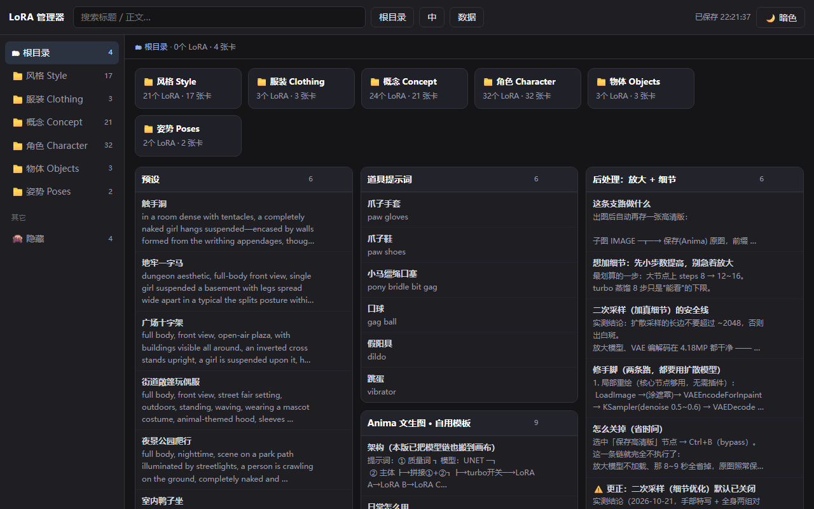
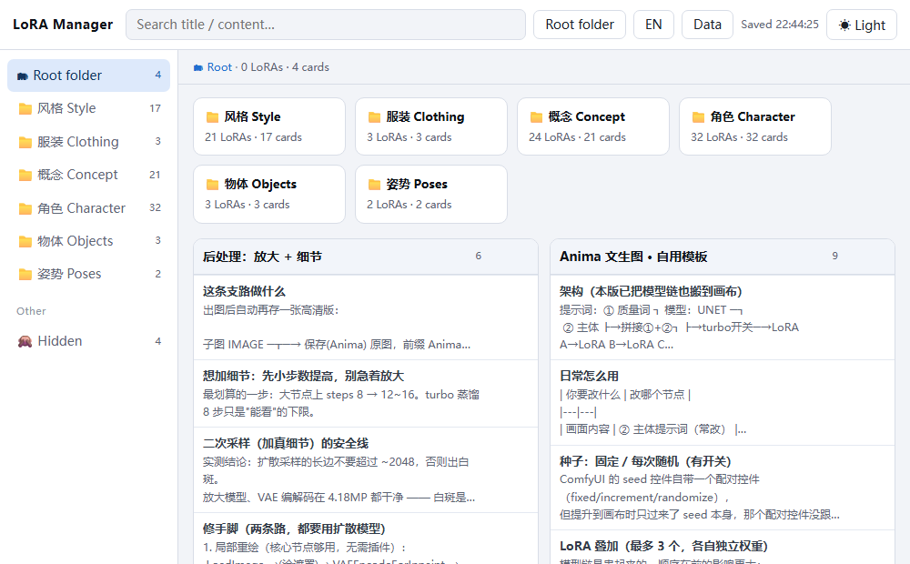
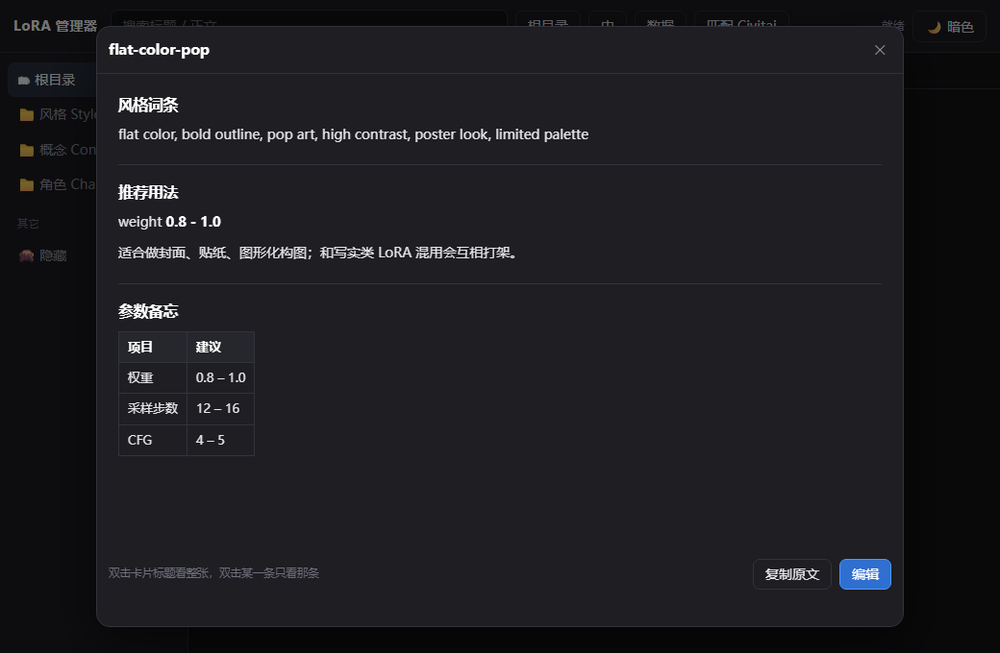

# LoRA 管理器 / LoRA Manager

一个给 ComfyUI 用的 **LoRA 文件管理器 + 提示词笔记本**：左边是真目录树，每个 LoRA 一张卡片，卡片下面挂任意多条提示词，勾选几条就能合并复制成一行粘进工作流。

A **LoRA file manager + prompt notebook** for ComfyUI: browse your real folder tree, one card per LoRA, any number of prompt entries under it, tick a few and copy them merged as a single line.





双击卡片按 markdown 预览 / Double-click a card for a rendered preview:



---

## 它解决的问题 / Why

LoRA 一多，触发词、推荐权重、几套服装的提示词就散在各处：便笺贴在画布边上、记事本里、脑子里。这个工具把这些东西**绑回 LoRA 文件本身**，并且直接操作磁盘上的真实目录。

When you have dozens of LoRAs, their trigger words and prompt variants end up scattered across sticky notes and text files. This tool binds that knowledge to the LoRA file itself, and works directly on your real folders.

## 功能 / Features

- **真目录**：文件夹就是磁盘上的文件夹；左栏目录树、面包屑、磁贴三层导航
- **两层卡片**：大卡片 = 一个 `.safetensors`，小卡片 = 一组提示词（人设 / 服装 / 触发词…）
- **多选合并复制**：按点选顺序拼成一行，分隔符可选逗号/换行/空格，可去重
- **预览**：双击卡片按 markdown 渲染（标题、加粗、代码、列表、表格、分隔线）
- **格式化**：全角标点转半角、逗号与空格规范化；选中文字时只格式化那一段
- **文件操作**：重命名、隐藏（不改文件）、移动、把 `.safetensors` 拖进窗口复制到当前目录
- **拖动排序**：手动顺序会保留；「按规则排序」是右键里的一次性操作
- **主题**：跟随系统 / 亮色 / 暗色
- **语言**：中文 / English
- **搜索**：在当前目录及其所有子目录里搜

## 环境 / Requirements

- Windows 10 / 11
- [.NET 10 桌面运行时](https://dotnet.microsoft.com/download)（Desktop Runtime）
- WebView2 运行时（Win10/11 的 Edge 自带）

## 运行 / Run

从源码构建：

```bash
git clone https://github.com/EasyRain/lora-manager.git
cd lora-manager
dotnet publish shell -c Release -r win-x64 --self-contained false -o out
```

把 `out/` 里的 exe 取名 `LoRA管理器.exe`，和这些放在同一个目录：

```
LoRA管理器.exe
*.dll  *.json           # dotnet publish 的其余产物
web/                    # 界面
data/                   # 自动创建：library.json + images/
```

双击即可。**第一次运行**会提示设置 LoRA 根目录：点顶栏「根目录」，选你的 `ComfyUI/models/loras`。

也可以提前用环境变量指定：

```bash
set LORA_MANAGER_ROOT=D:\ComfyUI\models\loras
```

## 数据在哪 / Where is my data

```
data/library.json      # 卡片内容，纯 JSON，UTF-8，可以手改
data/images/           # 卡片配图
library.json.bak       # 每次保存自动留的上一版
```

**备份就是复制整个 `data` 文件夹。**

`library.json` 结构：

```json
{
  "version": 3,
  "root": "D:/ComfyUI/models/loras",
  "hidden": ["Style/mylora.safetensors"],
  "cards": [
    {
      "id": "g_xxx",
      "path": "角色 Character/碧蓝航线 塔什干.safetensors",
      "dir": "",
      "title": "碧蓝航线 塔什干",
      "w": "0.7-1.0",
      "order": 3,
      "children": [
        { "id": "k_1", "title": "人设", "body": "tashkent, purple hair, ...", "img": "", "tags": [] }
      ]
    }
  ]
}
```

`path` 是相对 LoRA 根目录的路径；`dir` 只对没绑定文件的纯文本卡有效。

## 注意 / Caveats

- **重命名和移动会改磁盘上的真实文件**。ComfyUI 的工作流里存的是相对路径（`lora_name`），改完旧工作流就找不到它了；而且 **ComfyUI 要重启一次**才能看到新路径。顶栏「撤销移动」只记得最近一次。
- **隐藏不改文件**，只是不在这里显示，ComfyUI 照样能加载。
- 只支持 Windows（用了 WinForms + WebView2）。
- 界面中英双语，但**你自己的卡片内容不会被翻译**。

## 未签名说明 / Unsigned build

发布包**没有做代码签名**（个人项目没买证书）。所以第一次运行时 Windows SmartScreen 会拦一下：

> Windows 已保护你的电脑 → **更多信息** → **仍然运行**

点过一次之后同一台机器不再提示。嫌麻烦可以自己核对 SHA256（写在每个 Release 的说明里），或者干脆从源码自己编译。

The release is **not code-signed**. SmartScreen will warn on first launch — click *More info → Run anyway*. Verify the SHA256 in the release notes if you want to be sure.

## 从哪来 / Origin

最初是为了把 ComfyUI 工作流里十几个便笺（约 3 万字）抽成可检索的结构，后来一路长成了完整的 LoRA 管理器。

## 发版 / Publishing

维护者用，需要 `repo` 权限的 GitHub token：

```powershell
$env:GH_TOKEN = "ghp_xxx"
powershell -File publish.ps1 -Version 0.1.4
```

它会：编译 → 组装 → 打 zip → 算 sha256 → 建 Release → 上传附件，最后打印页面地址。

常用参数：

| 参数 | 作用 |
|---|---|
| `-NotesFile notes.md` | 用自己的发布说明（默认用内置模板，记得改「更新」那段） |
| `-Draft` | 发草稿，先自己看一眼再公开 |
| `-SkipBuild` | 复用 `release/` 里已有的 zip |
| `-Repo owner/name` | 默认从 `git remote` 推断 |
| `-NoProxy` | 不走代理 |

只想要 zip 不要发版：`powershell -File build-release.ps1 -Version 0.1.4`

## 许可 / License

[MIT](LICENSE)
